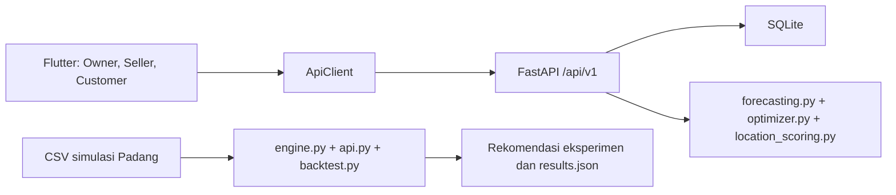

**Analisis proyek KopiCerdas AI / KopDas — 14 November 2026**

Kesimpulan: proyek sudah memiliki backend yang dapat dijalankan, dashboard Owner yang sebagian terhubung ke API, dan eksperimen AI yang dapat diulang. Statusnya masih prototipe parsial. Alur Owner–Seller–Customer belum memenuhi kebutuhan P0 dalam dokumen induk, terutama karena otorisasi, validasi kuantitas, reservasi stok, pembayaran, serta kontrak frontend dan backend.

Analisis mencakup kode Python dan Dart, schema database, endpoint, seed, pengujian, konfigurasi platform, seluruh dokumen Markdown, manual Word, dataset CSV, dan hasil backtest. Berkas bawaan platform Flutter ditinjau sebagai konfigurasi pendukung; dependensi virtual environment dan cache bukan kode produk yang diaudit.

Cakupan versi adalah checkout lokal pada HEAD 37f12d5. Branch main tertinggal 11 commit dari origin/main pada awal pemeriksaan dan 13 commit pada pemeriksaan terakhir, sesuai referensi Git lokal saat itu. Referensi remote berubah selama analisis. Temuan implementasi di bawah berlaku untuk checkout lokal; perubahan remote belum menjadi bagian dari kode yang dijalankan.

**Struktur dan alur data.** Flutter menggunakan Material 3 dan package HTTP. Backend memakai FastAPI, Pydantic, SQLAlchemy, SQLite, JWT, dan bcrypt. AI memakai NumPy, pandas, scikit-learn, SciPy/HiGHS, dan matplotlib.

Diagram memperlihatkan dua jalur AI. Endpoint aplikasi memanggil forecasting.py dan optimizer.py; pipeline yang menghasilkan backtest memakai engine.py. Fungsi recommend() di ai_engine/api.py belum dipanggil oleh router aplikasi. Karena itu, hasil backtest tidak menguji model yang saat ini dipakai dashboard.

| Area | Kondisi saat ini |
|---|---|
| Login dan role | Login menghasilkan token; API operasional belum memvalidasi token atau ownership. Frontend belum memiliki login. |
| Owner | Enam tab tersedia. Produk, stok pusat, transaksi, lokasi, dan optimasi memanggil API. Dialog distribusi mengirim perubahan ke backend. |
| Seller | Katalog, keranjang, dan pilihan pembayaran masih statis; tombol utama memiliki callback kosong. |
| Customer | Dua kartu seller statis; pemesanan, checkout, QRIS, dan status order belum menjadi alur interaktif. |
| Produk/kategori | Daftar tersedia dan POST produk tersedia. Edit produk, tambah kategori, pengelolaan seller, serta pengisian ulang stok belum ditemukan. |
| Stok/transaksi | Mutasi disimpan bersama dalam satu commit dan rollback tersedia. Idempotency walk-in bekerja untuk pengiriman ulang berurutan dengan key yang sama. Validasi dan reservasi masih bermasalah. |
| Order/pembayaran | Membuat order dan membaca status tersedia. Konfirmasi hanya melalui simulator; daftar order dan transisi pemrosesan belum tersedia. |
| Lokasi/peta | Daftar dan skor tersedia; tab peta masih berupa daftar. Adapter Maps/Places/Routes/Weather belum ditemukan. |
| AI | Forecast dan MILP dapat dijalankan; terdapat masalah pada input, pemetaan fitur, dan batas fallback. |
| Kualitas/deployment | Build web berhasil. Analyzer belum bersih, tes frontend tidak aktif, migration dan CI pengujian belum ditemukan. |

**Hal yang sudah kuat.** Pemisahan frontend, API, model, schema, dan modul AI sudah memberi fondasi yang jelas. Harga serta subtotal transaksi dihitung dari database dan snapshot unit_price disimpan. Distribusi dan transaksi memiliki rollback saat sebagian item gagal. AI menghasilkan alasan, versi model, status solver, dan label simulasi; rekomendasi tidak langsung memutasi stok. Eksperimen AI memakai pembagian waktu untuk evaluasi dan dokumentasinya menyatakan keterbatasan data sintetis.

**Temuan yang perlu diprioritaskan.** Kritis berarti dapat merusak akses, pembayaran, atau stok bila API dipakai sebagai sistem operasional. Tinggi berarti menghambat alur inti atau menghasilkan informasi bisnis yang salah. Menengah berarti perlu diperbaiki untuk konsistensi, pemeliharaan, dan kesiapan deployment.

1. **Kritis — Token tidak ditegakkan sebagai otorisasi.** Semua router operasional hanya bergantung pada get_db. GET inventory tanpa login menghasilkan HTTP 200; token palsu masih dapat membaca analytics; token Seller 1 dapat membaca stok Seller 2; distribusi juga dapat dibuat tanpa token. GET /auth/me mengambil user_id dari query, bukan identitas token. Tambahkan validasi JWT, role, serta ownership pada backend; actor_id dan seller_id operasional harus berasal dari identitas yang berwenang. Bukti: [auth.py](<C:/Users/lenovo/Documents/GitHub/kopdas/backend/app/api/v1/auth.py:30>), [inventory.py](<C:/Users/lenovo/Documents/GitHub/kopdas/backend/app/api/v1/inventory.py:12>), [api_client.dart](<C:/Users/lenovo/Documents/GitHub/kopdas/kopdas_app/lib/services/api_client.dart:12>).

2. **Kritis — Kuantitas negatif diterima sebagai penjualan dan order.** Uji transaksi quantity=-2 menghasilkan total -Rp36.000 dan menaikkan stok dari 45 menjadi 47. Pre-order quantity=-3 menghasilkan reserved_quantity=-3 dan total -Rp66.000. Metode pembayaran yang tidak dikenal juga diterima. Gunakan batas kuantitas positif, daftar item tidak kosong, enum metode/status, serta validasi harga dan ID. Bukti: [__init__.py](<C:/Users/lenovo/Documents/GitHub/kopdas/backend/app/schemas/__init__.py:92>), [transactions.py](<C:/Users/lenovo/Documents/GitHub/kopdas/backend/app/api/v1/transactions.py:49>), [orders.py](<C:/Users/lenovo/Documents/GitHub/kopdas/backend/app/api/v1/orders.py:40>).

3. **Kritis — Walk-in dapat menjual stok yang sudah direservasi.** Validasi walk-in memeriksa quantity fisik, bukan quantity minus reserved_quantity. Dengan stok 5 yang seluruhnya direservasi, penjualan 5 tetap berhasil dan menyisakan quantity=0, reserved=5. Webhook kemudian mengonfirmasi order itu, sementara max(0, ...) menutupi kekurangan fisik. Gunakan satu aturan availability untuk semua penjualan dan pembaruan database yang melindungi invariant stok. Bukti: [transactions.py](<C:/Users/lenovo/Documents/GitHub/kopdas/backend/app/api/v1/transactions.py:49>), [webhooks.py](<C:/Users/lenovo/Documents/GitHub/kopdas/backend/app/api/v1/webhooks.py:66>).

4. **Kritis untuk penggunaan operasional — Simulator pembayaran tidak memvalidasi identitas event dan tidak idempotent.** Merchant salah, signature salah, dan timestamp tahun 2020 tetap menghasilkan MATCHED/PAID karena pencocokan hanya berdasarkan nominal dan status PENDING. Event dengan provider_tx_id dan RRN yang sama dapat melunasi order baru setelah order pertama dibayar; uji menghasilkan dua payment_events dengan referensi yang sama. Simulator perlu dibatasi ke mode demo dan dilabeli konsisten. Kanal resmi harus memvalidasi signature, merchant, amount, status, waktu, dan referensi unik sebelum mutasi. Konektor provider resmi belum ditemukan. Bukti: [webhooks.py](<C:/Users/lenovo/Documents/GitHub/kopdas/backend/app/api/v1/webhooks.py:20>), [__init__.py](<C:/Users/lenovo/Documents/GitHub/kopdas/backend/app/schemas/__init__.py:156>), [__init__.py](<C:/Users/lenovo/Documents/GitHub/kopdas/backend/app/models/__init__.py:158>).

5. **Tinggi — Siklus order berhenti pada CONFIRMED.** Tidak ada endpoint daftar order Owner/Seller, transisi PREPARING hingga COMPLETED, pembatalan, atau job expiration. Order yang dibuat memiliki expires_at 30 menit, tetapi order dengan expiry yang sudah lewat masih PENDING_PAYMENT saat dibaca dan masih dapat dibayar melalui webhook. Reservasi tidak memiliki mekanisme pelepasan saat batal/expired; membuat order juga belum memiliki idempotency. Detail respons order tidak memuat item yang dibutuhkan Seller untuk pemrosesan. Bukti: [orders.py](<C:/Users/lenovo/Documents/GitHub/kopdas/backend/app/api/v1/orders.py:63>), [orders.py](<C:/Users/lenovo/Documents/GitHub/kopdas/backend/app/api/v1/orders.py:105>).

6. **Tinggi — Kontrak dashboard berbeda dari respons API.** Ini menyebabkan kegagalan yang terlihat bahkan saat backend berjalan.

| Pemakaian frontend | Kontrak backend saat ini | Dampak |
|---|---|---|
| GET /orders | Tidak ada endpoint tersebut; router order berada di /customer/orders | HTTP 404 lalu UI mengganti dengan order dummy |
| tx['total'] dan o['total'] | total_amount | Transaksi nyata tampil Rp0; KPI omzet keliru |
| recommended_quantity | recommended_stock | Rekomendasi nyata tampil “Alokasi: null Cup” |
| customer_name | customer_id, tanpa customer_name | Detail pelanggan diganti teks generik |

   Bukti: [owner_dashboard_view.dart](<C:/Users/lenovo/Documents/GitHub/kopdas/kopdas_app/lib/Frontend owner/owner_dashboard_view.dart:93>), [owner_dashboard_view.dart](<C:/Users/lenovo/Documents/GitHub/kopdas/kopdas_app/lib/Frontend owner/owner_dashboard_view.dart:284>), [owner_dashboard_view.dart](<C:/Users/lenovo/Documents/GitHub/kopdas/kopdas_app/lib/Frontend owner/owner_dashboard_view.dart:646>), [__init__.py](<C:/Users/lenovo/Documents/GitHub/kopdas/backend/app/schemas/__init__.py:114>). Samakan kontrak berdasarkan OpenAPI dan gunakan model Dart terstruktur untuk order, transaksi, serta rekomendasi.

7. **Tinggi — Fallback frontend menyembunyikan API gagal.** Error tiap request diganti produk, stok, transaksi, order, lokasi, atau rekomendasi contoh. Sebagian contoh tidak memiliki label simulasi. _errorMessage tidak dipakai, dan indikator “Backend Siap” selalu true tanpa health check. Ada insight cuaca serta kenaikan stok 25% yang ditulis statis. Seller dan Customer belum memanggil API untuk tombol Tambah, CASH, QRIS, atau Pesan. Sediakan state gagal/retry, demo eksplisit, health status nyata, login, dan alur kasir/checkout. Bukti: [owner_dashboard_view.dart](<C:/Users/lenovo/Documents/GitHub/kopdas/kopdas_app/lib/Frontend owner/owner_dashboard_view.dart:42>), [owner_dashboard_view.dart](<C:/Users/lenovo/Documents/GitHub/kopdas/kopdas_app/lib/Frontend owner/owner_dashboard_view.dart:342>), [main.dart](<C:/Users/lenovo/Documents/GitHub/kopdas/kopdas_app/lib/main.dart:42>), [main.dart](<C:/Users/lenovo/Documents/GitHub/kopdas/kopdas_app/lib/main.dart:574>), [main.dart](<C:/Users/lenovo/Documents/GitHub/kopdas/kopdas_app/lib/main.dart:721>).

8. **Tinggi — Forecast aplikasi kehilangan waktu dan identitas seri.** Adapter membaca timestamp transaksi tetapi membuangnya, tidak mengagregasikan penjualan per hari, tidak mengurutkan histori menurut waktu, dan selalu mengirim stockout_flag=False. Model mengganti hari yang tidak tersedia dengan Rabu. Saat inferensi ML, loc_idx dan prod_idx selalu 0. Uji dua seri dengan penjualan 3 dan 100 cup menghasilkan prediksi yang sama: 24 cup per hari. Filter location_ids/product_ids juga diabaikan. Agregasi harian dan pemetaan kategori yang sama antara training dan inference perlu diperbaiki sebelum hasil digunakan untuk distribusi. Bukti: [ai.py](<C:/Users/lenovo/Documents/GitHub/kopdas/backend/app/api/v1/ai.py:19>), [forecasting.py](<C:/Users/lenovo/Documents/GitHub/kopdas/backend/app/ai_engine/forecasting.py:37>), [forecasting.py](<C:/Users/lenovo/Documents/GitHub/kopdas/backend/app/ai_engine/forecasting.py:131>).

9. **Tinggi — Optimizer dapat mengalokasikan stok yang tidak tersedia atau melampaui kapasitas saat fallback.** Produk yang tidak ada di central_inventory dianggap memiliki stok 1.000 pada MILP, atau 100 pada fallback. Uji gudang kosong tetap menghasilkan alokasi 10 cup. Fallback memakai rata-rata jumlah produk per seller; untuk tiga produk di lokasi A dan satu di B, kapasitas A=9 menghasilkan alokasi A=12. Kapasitas gerobak 120 masih hardcode dan belum memperhitungkan stok seller yang sudah ada. Solver belum memiliki time limit. Fallback juga menghasilkan status dengan teks tambahan yang tidak cocok dengan assertion tes. Bukti: [optimizer.py](<C:/Users/lenovo/Documents/GitHub/kopdas/backend/app/ai_engine/optimizer.py:73>), [optimizer.py](<C:/Users/lenovo/Documents/GitHub/kopdas/backend/app/ai_engine/optimizer.py:159>), [ai.py](<C:/Users/lenovo/Documents/GitHub/kopdas/backend/app/api/v1/ai.py:75>).

10. **Tinggi — Analytics belum merepresentasikan periode dan seluruh penjualan.** Parameter days hanya ditulis pada respons; query tidak memfilter tanggal. Uji days=1 dan days=7 menghasilkan omzet sama meski seed berisi transaksi tujuh hari. Pre-order PAID tidak masuk agregasi karena endpoint hanya membaca transactions dan transaction_items; pembayaran order Rp100.000 tidak menambah omzet analytics. Dashboard menghitung ulang KPI dari riwayat maksimum 50 transaksi dan tidak memfilter “hari ini”. Definisikan ledger penjualan dan agregasi backend yang konsisten tanpa menghitung order dua kali. Bukti: [analytics.py](<C:/Users/lenovo/Documents/GitHub/kopdas/backend/app/api/v1/analytics.py:20>), [transactions.py](<C:/Users/lenovo/Documents/GitHub/kopdas/backend/app/api/v1/transactions.py:115>), [owner_dashboard_view.dart](<C:/Users/lenovo/Documents/GitHub/kopdas/kopdas_app/lib/Frontend owner/owner_dashboard_view.dart:317>).

11. **Menengah — Constraint database belum menjadi pengaman terakhir.** PRAGMA foreign_keys bernilai 0 pada engine aplikasi. POST produk menerima kategori yang tidak ada dan harga -1. Inventory belum memiliki unique constraint untuk product_id/scope_type/scope_id maupun check constraint stok/reservasi. ID produk menggunakan timestamp detik sehingga dua pembuatan pada detik sama dapat berbenturan. Tidak ditemukan conditional update, locking, atau versioning untuk request stok bersamaan; risiko konkurensi ini ditinjau dari kode, belum diuji dengan beban paralel. Bukti: [database.py](<C:/Users/lenovo/Documents/GitHub/kopdas/backend/app/core/database.py:9>), [__init__.py](<C:/Users/lenovo/Documents/GitHub/kopdas/backend/app/models/__init__.py:67>), [products.py](<C:/Users/lenovo/Documents/GitHub/kopdas/backend/app/api/v1/products.py:39>).

12. **Menengah — Kandidat lokasi dan penjelasan skor tidak konsisten.** /locations/candidates mengembalikan titik aktif sekaligus kandidat. Semua empat lokasi seed berstatus is_active=True sehingga UI menghitung empat gerobak aktif walaupun hanya dua lokasi punya seller; kandidat juga tampil “OPERASIONAL”. Scorer menghasilkan factors, confidence, dan kualitas data, tetapi router hanya meneruskan score. Bukti: [locations.py](<C:/Users/lenovo/Documents/GitHub/kopdas/backend/app/api/v1/locations.py:38>), [locations.py](<C:/Users/lenovo/Documents/GitHub/kopdas/backend/app/api/v1/locations.py:52>), [owner_dashboard_view.dart](<C:/Users/lenovo/Documents/GitHub/kopdas/kopdas_app/lib/Frontend owner/owner_dashboard_view.dart:319>), [owner_dashboard_view.dart](<C:/Users/lenovo/Documents/GitHub/kopdas/kopdas_app/lib/Frontend owner/owner_dashboard_view.dart:577>).

13. **Menengah — Label REAL/SIMULASI tidak berasal dari sumber data.** Seed transaksi tidak menyimpan label; analytics mengembalikan REAL dan order simulator juga dibaca sebagai REAL. Forecast menerima data_label dari request, sehingga histori demo dapat dilabeli REAL oleh pemanggil. Uji filter yang tidak ada dengan data_label=REAL tetap menghasilkan forecast berlabel REAL. Simpan provenance pada data dan turunkan label dari input yang benar-benar dipakai. Bukti: [analytics.py](<C:/Users/lenovo/Documents/GitHub/kopdas/backend/app/api/v1/analytics.py:46>), [orders.py](<C:/Users/lenovo/Documents/GitHub/kopdas/backend/app/api/v1/orders.py:95>), [ai.py](<C:/Users/lenovo/Documents/GitHub/kopdas/backend/app/api/v1/ai.py:49>).

14. **Menengah — Startup dan konfigurasi belum konsisten antar mesin.** DATABASE_URL relatif terhadap working directory. Dua DB lokal ditemukan dengan isi berbeda: root mempunyai 8 transaksi dan 1 order saat dibaca; backend mempunyai 7 transaksi dan 0 order. Seed berjalan saat import, hanya memeriksa apakah sudah ada user, dan belum memiliki reset demo atau migration. API URL Flutter masih 127.0.0.1, sehingga deployment di server lain atau perangkat lain belum terkonfigurasi. CORS mengabaikan daftar settings dan mengizinkan semua origin. Kode menyediakan default secret demo serta fallback password plaintext yang perlu dibatasi sesuai environment. README root hanya berisi judul dan README Flutter masih bawaan. Bukti: [config.py](<C:/Users/lenovo/Documents/GitHub/kopdas/backend/app/core/config.py:20>), [main.py](<C:/Users/lenovo/Documents/GitHub/kopdas/backend/app/main.py:12>), [main.py](<C:/Users/lenovo/Documents/GitHub/kopdas/backend/app/main.py:30>), [security.py](<C:/Users/lenovo/Documents/GitHub/kopdas/backend/app/core/security.py:8>), [constants.dart](<C:/Users/lenovo/Documents/GitHub/kopdas/kopdas_app/lib/core/constants.dart:8>).

15. **Menengah — Pengujian belum mencakup kontrak penerimaan.** Ada 10 tes backend, walaupun judul suite menyebut T01–T12. Tidak ada uji role/ownership, quantity negatif, reservasi walk-in, expiration, replay webhook, atau request bersamaan. Tes yang bernama “ambiguity” hanya membuat satu order. Tes analytics hanya memeriksa omzet positif. Tes distribusi hanya memeriksa stok pusat. Semua isi widget_test.dart dikomentari, dan workflow CI pengujian belum ditemukan. Masalah analyzer mencakup BuildContext setelah await, field error yang tidak dipakai, ekspresi null yang tidak diperlukan, dan metode Owner lama yang tidak dirujuk. Bukti: [test_core_flow.py](<C:/Users/lenovo/Documents/GitHub/kopdas/backend/tests/test_core_flow.py:36>), [test_core_flow.py](<C:/Users/lenovo/Documents/GitHub/kopdas/backend/tests/test_core_flow.py:88>), [test_core_flow.py](<C:/Users/lenovo/Documents/GitHub/kopdas/backend/tests/test_core_flow.py:122>), [widget_test.dart](<C:/Users/lenovo/Documents/GitHub/kopdas/kopdas_app/test/widget_test.dart:1>).

**Dataset dan eksperimen AI.** Semua lima CSV di data/ identik byte per byte dengan salinannya di backend/app/ai_engine/data/. Pemeriksaan tidak menemukan sel kosong atau baris duplikat persis pada CSV tersebut. Ini tidak menjadikan data representatif lapangan: generator sengaja menanam pola demand dan stockout.

| Dataset | Jumlah baris | Isi utama |
|---|---:|---|
| locations.csv | 4 | Lokasi Padang dan koordinat |
| weather.csv | 84 | Cuaca simulasi, 10 Agustus–1 November 2026 |
| daily_sales.csv | 1.590 | Penjualan harian enam produk, tiga kategori |
| transactions.csv | 12.632 | Transaksi sintetis per cup |
| ground_truth_demand.csv | 2.016 | Demand sebenarnya dalam simulasi untuk evaluasi |

Dataset menggunakan lokasi Padang dan ID produk/kategori yang berbeda dari seed backend Jakarta. Data 12.632 transaksi CSV belum menjadi histori database aplikasi, yang seed awalnya hanya berisi tujuh transaksi contoh. Dibutuhkan adapter ID, status, waktu, dan provenance sebelum pipeline eksperimen dapat dipakai pada database produk.

Backtest tiga minggu, 12 Oktober–1 November 2026, berhasil dijalankan ulang tanpa menimpa results.json. Akurasi dan hasil kebijakan identik dengan hasil tersimpan.

| Forecast eksperimen | MAE cup | WAPE |
|---|---:|---:|
| Hari sama minggu lalu | 6,29 | 33,5% |
| Rata-rata empat hari sama | 5,59 | 29,8% |
| Model ML | 5,42 | 28,9% |

| Kebijakan simulasi | Laba tiga minggu | Cup sisa |
|---|---:|---:|
| Manual | Rp13.259.200 | 1.251 |
| Rumus +10% | Rp14.447.875 | 540 |
| AI forecast + MILP | Rp17.526.550 | 710 |

Laba simulasi AI naik sekitar 32,2% dibanding Manual. Perbaikan MAE terhadap baseline rata-rata empat hari sekitar 3%; klaim peningkatan laba tidak sama dengan peningkatan akurasi forecast dan belum menjadi bukti dampak lapangan.

Ada keterbatasan evaluasi tambahan: fungsi evaluate() menghitung permintaan tak terlayani hanya pada lokasi yang ada dalam rencana setelah lokasi tanpa stok dibuang. Uji satu lokasi buka yang seluruh demand-nya terpenuhi dan satu lokasi tutup dengan demand 20 menghasilkan hilang=0. Angka hilang_cup pada kebijakan belum mengukur demand seluruh jaringan. Definisi metrik dan kesetaraan batas kapasitas antar kebijakan perlu ditetapkan sebelum memakai hasil itu dalam pitch. Bukti: [backtest.py](<C:/Users/lenovo/Documents/GitHub/kopdas/backend/app/ai_engine/backtest.py:28>).

Pipeline eksperimen juga sudah mempunyai pembagian stok kategori ke produk dengan metode sisa terbesar dan assignment seller menggunakan algoritma Hungarian. Keduanya berguna sebagai bahan integrasi berikutnya, setelah kontrak ID dan input database disatukan.

**Bukti verifikasi yang dijalankan.**

| Pemeriksaan | Hasil nyata |
|---|---|
| pytest tests/test_core_flow.py pada DB sementara | 10 passed, 50 warnings; exit 0 |
| flutter analyze --no-pub | 14 temuan: 4 warning dan 10 info; exit 1 |
| flutter build web --no-pub | Berhasil; output kopdas_app/build/web |
| Pemeriksaan tambahan API/database pada SQLite memori | 19 pemeriksaan; mengonfirmasi masalah akses, stok, webhook, order, analytics, filter, dan constraint |
| Pemeriksaan AI dengan input terkendali | Mengonfirmasi prediksi seri identik, alokasi tanpa stok gudang, dan fallback melampaui kapasitas |
| Backtest ulang di memori | Akurasi dan hasil kebijakan identik dengan results.json |
| Profiling CSV dan pembacaan DB | Lima dataset diperiksa; dua database berbeda terkonfirmasi |

Backend pengujian memakai database terpisah; database aplikasi hanya dibaca. Analisis tidak mengubah kode aplikasi. Laporan ini merupakan berkas dokumentasi baru dan build web menghasilkan artefak yang diabaikan Git. Peninjauan UI dilakukan dari kode dan hasil analyzer/build; tampilan pada browser/perangkat serta build native belum diuji. Konektivitas dan validasi provider pembayaran resmi belum dapat dinilai karena adapter implementasinya belum ditemukan.

**Urutan pekerjaan yang disarankan.**

1. Backend dan QA menyamakan kontrak OpenAPI serta definisi status, lalu memperbaiki JWT/ownership, kuantitas, availability, dan idempotency. Tambahkan kasus gagal dan rollback yang membuktikan invariant stok serta isolasi pengguna.
2. Backend dan Integration melengkapi siklus order, pelepasan reservasi, dan validasi event pembayaran. Batasi simulator ke environment demo; pembayaran resmi perlu implementasi adapter provider yang benar-benar tersedia.
3. Frontend menyelaraskan endpoint/field Owner, menampilkan kegagalan API secara jujur, lalu membangun login, kasir Seller, discovery, checkout, dan status order Customer. Uji layout mobile, tabel, dan aksi sesudah request selesai.
4. AI dan Backend memilih jalur AI utama, menyatukan ID/data harian, memperbaiki pemetaan inference, dan memvalidasi semua batas MILP/fallback. Pertahankan backtest sebagai evaluasi dengan label simulasi dan definisi metrik yang jelas.
5. Integration dan QA menyiapkan konfigurasi URL/environment, satu lokasi DB, migration/seed/reset demo, README operasional, CI, dan demo yang dapat diulang.

Dokumen acuan perlu diselaraskan sebelum tim memperluas scope: manual lama menjadikan Customer/pre-order prioritas lanjutan, sementara dokumen induk menjadikannya P0. Aturan pembayaran juga memuat paragraf manual lama berdampingan dengan koreksi tanpa verifikasi manual. Tetapkan satu versi operasional yang konsisten agar lima divisi menguji alur yang sama.

